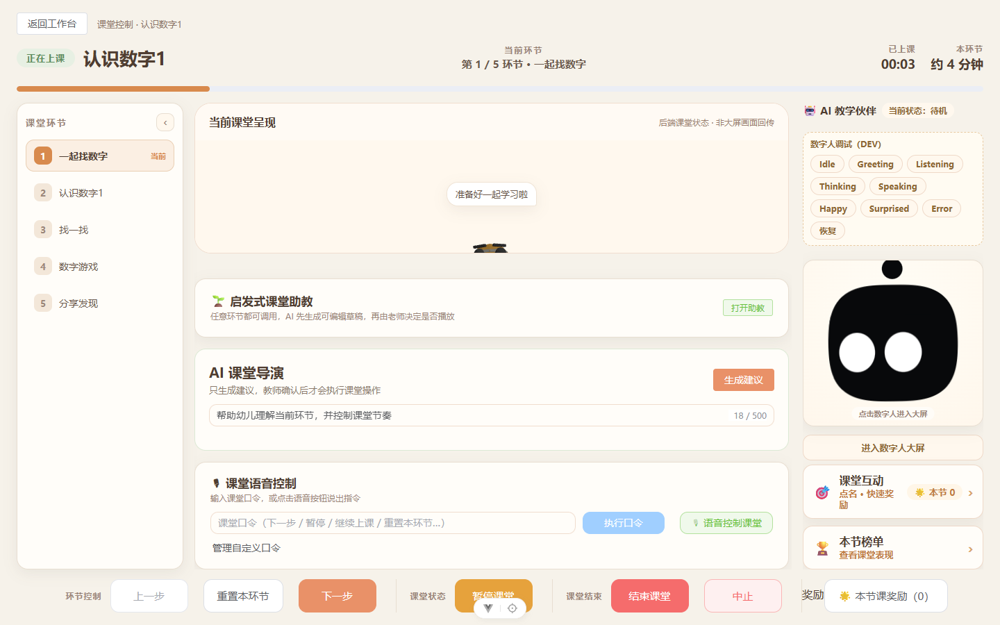
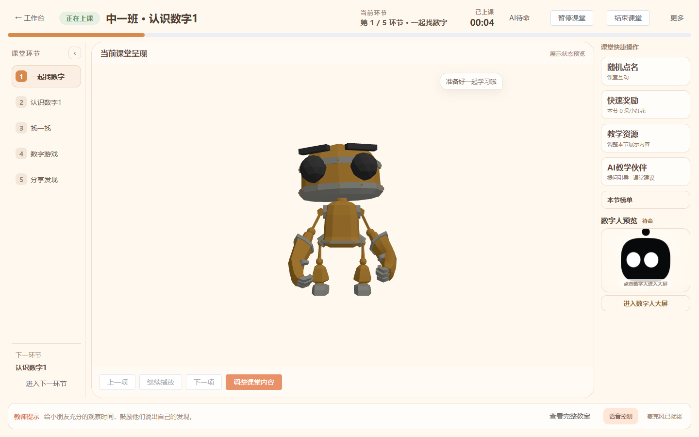
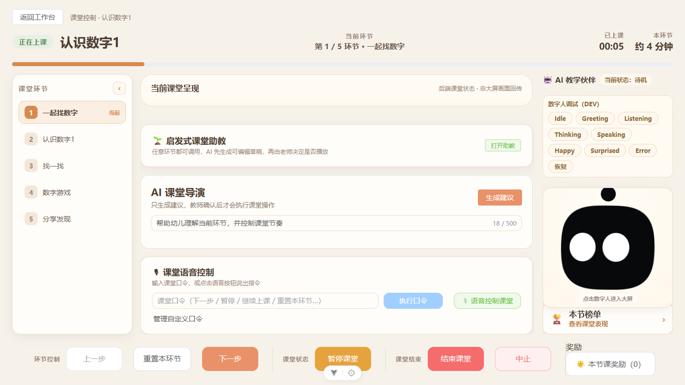
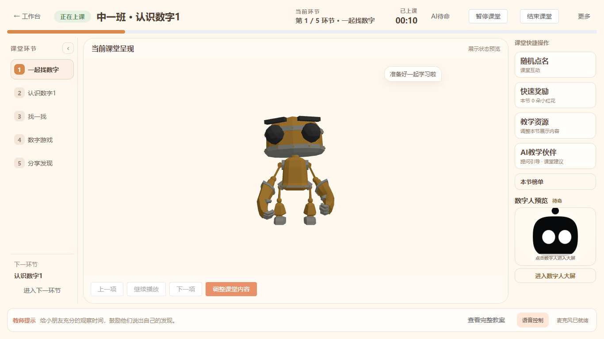
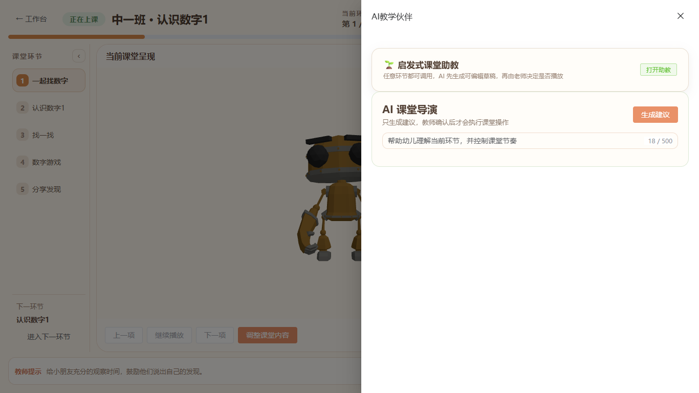

# 课堂工作台 UI 层级收口与视觉验收

日期：2026-10-13。范围限定 LessonClassroomView 及必要展示组件；暂停新增业务能力。本轮使用产品设计审查流程，先截图再调整、逐张检查保存截图，不以构建成功代替视觉验收。

## Before → After

| 区域 | Before | After |
| --- | --- | --- |
| 第一视觉中心 | 三张 AI/语音卡片与右侧 DEV 面板 | 填满中央栏的课堂呈现舞台 |
| 1440×900 主舞台 | 856×217，人物被裁切 | 1036×734，整页面积约 58.7% |
| 1366×768 主舞台 | 782×64，只剩标题 | 962×602，整页面积约 55.2% |
| AI 助教/导演 | 常驻中央大卡片 | 右侧轻量入口，按需打开抽屉 |
| 语音 | 大输入框和多个按钮 | 底部状态条；输入、口令管理、候选确认保留在抽屉 |
| 顶部 | 独立返回行、大量指标 | 工作台返回、真实班级/教案名、环节/计时、AI 状态、暂停/结束 |
| 底部 | 推进/重置/暂停/结束/中止/奖励混排 | 单行教师提示、完整教案入口和语音状态 |
| 危险/低频操作 | 常驻底部 | 更多抽屉：重复环节、奖励记录、中止（继续走原二次确认） |
| 数字人 | 大型右侧主卡，DEV 默认暴露 | 小型可放大缩略预览；主舞台复用已有 immersive 尺寸 |
| 调试 | 只凭 DEV 环境即显示 | 仅开发环境显式 `?debug=1` 开启；正常课堂隐藏开发工具浮条 |

面积统计为 Live Presentation 容器（含其标题/资源控制），不是模型轮廓或像素镜像面积。学生端渲染回执、完整媒体预览仍是此前后续任务，不在本轮扩大功能。

## 页面 Wireframe

```text
工作台返回 | 班级·教案 | 当前环节/计时 | AI状态 | 暂停 | 结束 | 更多
------------------------------------------------------------------
教学流程   |                                                | 快捷操作
当前/完成  |             当前课堂呈现                        | 随机点名
后续环节   |             数字人或资源预览                    | 快速奖励
可跳转折叠 |                                                | 教学资源
           |                                                | AI教学伙伴
下一环节   | 上一项 | 播放/暂停 | 下一项 | 调整课堂内容       | 榜单/缩略数字人
------------------------------------------------------------------
教师提示                                      | 完整教案 | 语音状态
```

儿歌、故事、出题、小游戏没有新增独立快捷功能或假按钮；保留现有资源搜索及 AI 入口，未完成的次级快捷入口不展示。

## Reused / Changed

复用 ClassroomHeader、Teaching Flow、LivePresentationPreview、PresentationQueuePanel、原助教/导演/语音组件、ClassroomPartnerPanel、统一 fullscreen 状态与转场、InteractionFullscreenView、FullscreenLeaderboard、ClassRewardDrawer、ResourcePlayer，以及原命令/快照/奖励/点名路径。

新建 ClassroomQuickActions 仅组织入口并上抛事件，不实现第二套点名/奖励/命令业务。

ClassroomHeader 增加导航/操作插槽，Teaching Flow 增加下一环节插槽；主页面重新组合组件。完整教案抽屉展示当前环节和其他课堂步骤，不请求修改原教案。

修复两个展示组件缺少 ElButton/ElInput 显式导入的问题：此前组件测试使用全局插件掩盖了真实浏览器未注册控件的问题。本轮真实浏览器先捕获警告，再修复注册，保留原回调和服务契约。

语音面板改成懒加载抽屉后，父页面继续加载已有自定义口令偏好，避免不打开抽屉就无法使用原语音能力。录音/识别/执行函数没有改写。

## 修改与新增文件

修改：

- frontend/src/views/LessonClassroomView.vue
- frontend/src/components/classroom/LivePresentationPreview.vue
- frontend/src/components/classroom/PresentationQueuePanel.vue
- frontend/src/components/classroom/ClassroomHeader.vue
- frontend/src/components/classroom/ClassroomStepSidebar.vue
- frontend/src/components/classroom/ClassroomPartnerPanel.vue
- frontend/tests/component/lesson-classroom-rightcol.spec.ts

新增：

- frontend/src/components/classroom/ClassroomQuickActions.vue
- frontend/tests/e2e/classroom-console-composition.spec.ts
- 本报告及 docs/images/classroom-console-composition 的实际截图

本轮未改后端、数据库、迁移、Device Online、Command Bus、Queue Store、Roll Call、Reward、Screen Sync 或 Snapshot。工作树里的这些已有未提交改动属于之前批次，不能计入本轮 UI diff。

## 真实视觉检查

浏览器：本机 Chrome/Playwright。由于没有可用的应用内浏览器控制接口，经授权使用本机浏览器；隔离前后端与临时 SQLite，正式 API 签发、真实 ClassroomScreen 自动心跳和真实 ClassroomRun，不模拟心跳或课堂响应，不向当前正式库添加测试课堂。

页面状态：中一班·认识数字1、5 个教学环节、数字人待机。截图在当前审查中保存并逐张打开；早期 AI 抽屉的转场截图被拒绝，最终等待抽屉完整进入视口后重新捕获。

1. Before 1440×900：不合格，主舞台被压缩/裁切，辅助卡片与 DEV 抢中心。
2. Before 1366×768：不合格，舞台只有标题区，核心播放控制不可见。
3. After 1440×900：通过本轮层级检查，主舞台与完整核心控制可见，辅助功能默认不占中央空间。
4. After 1366×768：通过本轮层级检查，55.2% 主舞台、快捷入口、计时/暂停/结束与教师提示均在视口内。
5. AI/教案抽屉和数字人/互动/榜单全屏：入口可达、关闭后回到原课堂，未改变 Run status/version 或当前 playerRecoverySuggestion。

| 问题 | 实测结论 |
| --- | --- |
| 第一眼是否为课堂呈现？ | 中央容器及数字人主体最大；不是输入卡片列表 |
| AI 是否抢舞台？ | 默认只保留状态/入口，助教和导演在抽屉内 |
| 教案是否抢舞台？ | 默认只有单行提示；完整内容在抽屉 |
| 高频入口是否 1～2 次点击可达？ | 随机点名/奖励/资源/AI 一次进入对应操作面板；实际点名/奖励仍需原确认/选择 |
| 是否像后台控制面板？ | 正常界面没有工程指令输入、动作调试按钮或危险操作排排坐 |
| 是否需要大量阅读？ | 主界面短标题、步骤和单行提示，长输入/说明按需展开 |
| 当前内容是否明显？ | 舞台固定居中，数字人用已有 immersive 布局，资源操作紧邻舞台 |
| 低分辨率核心操作是否完整？ | 1366×768 通过实际截图与按钮可见性检查 |

截图：







## Tests

- 前端 type-check 与生产构建通过；仅有既有 3D 包体积告警。
- 课堂全屏、互动全屏、右栏、奖励/榜单同步、队列相关 37 项回归通过。
- 最终真实浏览器场景通过：两种分辨率，舞台面积在 55%～65%，核心操作可见；打开资源抽屉不切屏，数字人/互动/榜单放大返回，打开完整教案不改课堂状态。
- git diff --check 通过。
- 曾出现 UI 旧定位断言失败（大数字人主卡/奖励计数旧位置）和全屏榜单同名嵌套节点的 strict selector 误报；更新布局断言与精确定位后重跑。奖励成功/失败、排行榜权威来源及全屏行为断言保留。

## 可访问性与证据边界

保留语义按钮、抽屉关闭、Escape 返回和已有 reduced-motion 转场；教学流程增加 aria-current 与完整标题提示。截图不能证明完整 WCAG 合规，本轮没有声称完成屏幕阅读器、缩放、所有键盘路径或真实麦克风/AI模型验收。

视觉确认限于所要求的两个桌面分辨率。音视频/PPT 完整只读预览、渲染 ACK、真实移动端协同仍为既有后续事项，本轮不扩展。真实教案标题仍来自后端，没有通过替换标题去隐藏或修改现有测试教案；截图隔离数据使用教师语义标题。

## git diff / Handoff

本轮仅前端 UI 组合/样式/必要控件注册、对应测试与文档。既有 dirty worktree 保留，ClassroomPartnerPanel 原暂存内容未重置；其本轮 UI 修改留在工作区，未暂存。未 commit、未 push。

产品设计审查影响了本轮做法：先以截图证明舞台压缩问题，再按面积收口，并拒绝动画中不完整的抽屉截图。没有另建主题、替换模型或重写业务。

完成后停止新增开发，等待用户查看真实课堂页面。
